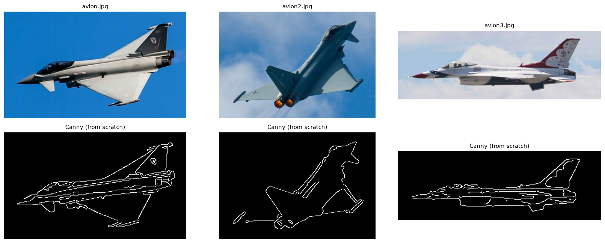
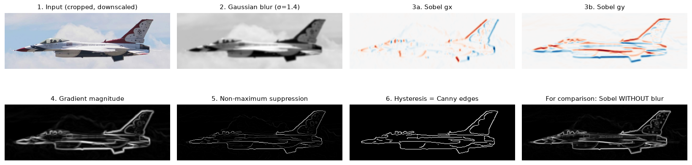
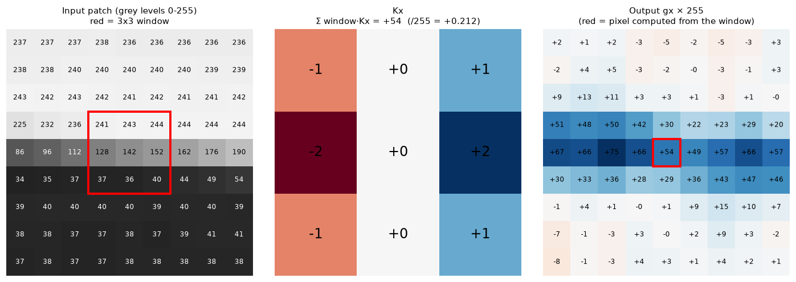
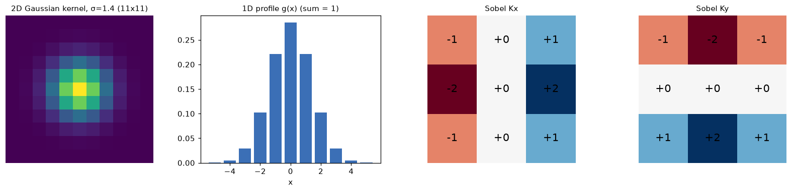
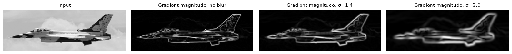
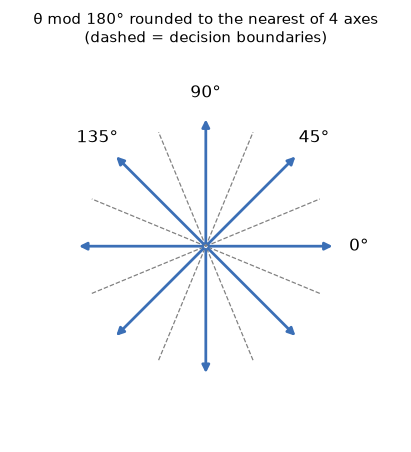
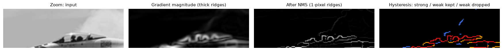
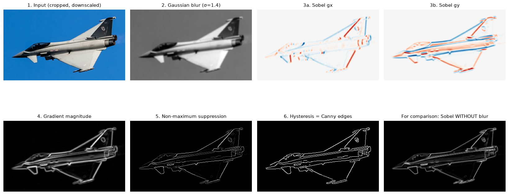
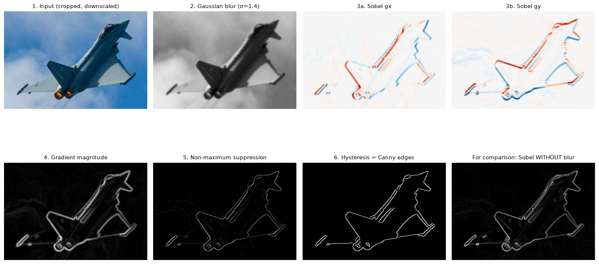

# Image Processing For Object Detection

I rebuilt convolution, Gaussian blur, the Sobel gradient and the **Canny edge detector** from scratch with NumPy. No `cv2.Canny`, no `scipy.ndimage`. SciPy and OpenCV are only there to check that my results are right.



## Contents

- [Usage](#usage)
- [How it works](#how-it-works)
  1. [Convolution](#1-convolution)
  2. [Gaussian blur](#2-gaussian-blur)
  3. [Sobel gradient](#3-sobel-gradient)
  4. [Non-maximum suppression](#4-non-maximum-suppression)
  5. [Hysteresis thresholding](#5-hysteresis-thresholding)
- [Notes and limits](#notes-and-limits)
- [References](#references)

## Usage

Needed : Python 3 with `numpy`, `matplotlib`, `pillow` and `scipy` (for the checks). `opencv-python` is optional. Without it, the comparison with OpenCV's Canny is just skipped.

```bash
pip install numpy scipy matplotlib pillow opencv-python

python src/Image_Processing.py                    # Synthetic Test Image (plane in the sky)
python src/Image_Processing.py Results/avion.jpg  # Input image
```

The script starts with a few checks against SciPy and OpenCV. Then it saves a figure of every step as `resultats.png` in the current folder.

| Function | Role |
|---|---|
| `conv2d_naive(img, k)` | convolution with plain loops (reference, slow) |
| `conv2d(img, k)` | vectorized convolution (`sliding_window_view` + `einsum`) |
| `gaussian_kernel(sigma)`, `gaussian_blur_separable(img, sigma)` | Gaussian blur, in 2D or as two 1D passes |
| `sobel(img)` | `gx`, `gy`, magnitude and angle of the gradient |
| `non_max_suppression(mag, theta)` | thins the edges down to 1 pixel |
| `hysteresis(nms, low, high)` | double threshold and edge tracking |
| `canny(img, sigma, low_ratio, high_ratio)` | the whole pipeline |

## How it works

Canny is a chain of small steps. Here they are one by one on `Results/avion3.jpg`. I cropped the image around the plane and shrunk it, because the Python loops are slow on big photos.



A grey image is a function $I(x, y)$ giving the brightness of each pixel (0 is black, 1 is white). An **edge** is a spot where $I$ changes fast, so where the gradient

$$\nabla I = \left(\frac{\partial I}{\partial x},\ \frac{\partial I}{\partial y}\right)$$

is large. The hard part is estimating this gradient on a noisy image made of discrete pixels, and then keeping only what matters.

### 1. Convolution

Every filter below is a **2D convolution** of the image $I$ with a small kernel $K$ (size $k_h \times k_w$):

$$(I * K)[i, j] = \sum_{u}\sum_{v} I[i - u,\ j - v]\; K[u, v]$$

Concretely, you flip the kernel and slide it over the image. At each pixel, you multiply the window around it by the kernel, value by value, and add everything up. The code does exactly this (`k = k[::-1, ::-1]`), and the result matches `scipy.signal.convolve2d`.

Here is a real example from `avion3`. The red 3×3 window sits on a dark-to-bright transition. Its weighted sum with Sobel's $K_x$ is $+54$, which is $+0.212$ on the 0–1 scale:



On the borders, the image is padded by mirroring it (`mode="symmetric"`), so the output keeps the same size as the input.

There are two versions of the convolution:

- `conv2d_naive` uses two nested Python loops. It costs $O(HW\,k_hk_w)$ and is slow.
- `conv2d` builds a view of all the windows at once (`sliding_window_view`, no copy) and combines it with the kernel using `einsum`. It's the same math, but it runs in C.

### 2. Gaussian blur

Taking a derivative boosts noise, because the difference between two neighbouring pixels is mostly noise. So I blur the image first with a Gaussian kernel:

$$g_\sigma(x) = \frac{1}{Z}\, e^{-\frac{x^2}{2\sigma^2}}, \qquad G_\sigma(x, y) = g_\sigma(x)\, g_\sigma(y)$$

- The kernel is cut at $\pm 3\sigma$ (radius $r = \lceil 3\sigma \rceil$). That still holds about 99.7 % of the mass.
- $Z$ makes the weights **sum to 1**, so the average brightness doesn't change.
- The Gaussian is **separable**: $G_\sigma = g_\sigma g_\sigma^{\top}$. A 2D convolution is the same as a 1D one along the rows followed by a 1D one along the columns. That's $2k$ multiplications per pixel instead of $k^2$.

$$I * G_\sigma = (I * g_\sigma^{\text{row}}) * g_\sigma^{\text{col}}$$



Canny uses $\sigma = 1.4$ here. A bigger $\sigma$ kills more noise, but it also smears the real edges:



### 3. Sobel gradient

Sobel approximates the partial derivatives with two small kernels. Each one takes a difference in one direction and smooths a little with $[1, 2, 1]$ in the other:

$$K_x = \begin{pmatrix} -1 & 0 & +1 \\ -2 & 0 & +2 \\ -1 & 0 & +1 \end{pmatrix}, \qquad K_y = K_x^{\top} = \begin{pmatrix} -1 & -2 & -1 \\ 0 & 0 & 0 \\ +1 & +2 & +1 \end{pmatrix}$$

$$G_x = I * K_x, \qquad G_y = I * K_y$$

A *true* convolution flips the kernel, so it gives $-\partial I/\partial x$. The code adds a minus sign (`gx = -conv2d(img, KX)`) to get the gradient pointing towards brighter pixels. I tested it on a ramp $I(x, y) = x$. At the centre, $G_x = 8$ (the weights $1+2+1$ times a change of 2 across the window) and $G_y = 0$.

Then come the magnitude, which is the edge strength, and the direction:

$$\|\nabla I\| = \sqrt{G_x^2 + G_y^2}, \qquad \theta = \text{atan2}(G_y, G_x)$$

$G_x$ reacts to **vertical** edges and $G_y$ to **horizontal** ones. In the figure above, red is positive and blue is negative. The gradient is always perpendicular to the edge.

### 4. Non-maximum suppression

After Sobel, the edges are several pixels thick. To get thin lines, I keep a pixel only if it's a **local maximum along the gradient direction**, meaning across the edge. Otherwise it goes to 0.

The angle is folded into $[0°, 180°)$ because the sign doesn't matter here. Then it's rounded to one of 4 axes, which tells me which two neighbours to compare with:

| $\theta$ | neighbours $(\Delta i, \Delta j)$ |
|---|---|
| 0° | $(0, \pm 1)$ |
| 45° | $(\pm 1, \pm 1)$ |
| 90° | $(\pm 1, 0)$ |
| 135° | $(\pm 1, \mp 1)$ |

$$\text{NMS}[i,j] = \begin{cases} \|\nabla I\|[i,j] & \text{if } \|\nabla I\|[i,j] \ge \|\nabla I\|[\text{both neighbours}] \\ 0 & \text{otherwise} \end{cases}$$



### 5. Hysteresis thresholding

One threshold isn't enough. If it's too high, the edges break into pieces. If it's too low, noise shows up. Canny uses two thresholds, set as fractions of the strongest response ($M = \max \text{NMS}$):

$$T_{high} = 0.3\,M, \qquad T_{low} = 0.1\,M$$

- $\text{NMS} \ge T_{high}$: **strong** pixel, always an edge.
- $T_{low} \le \text{NMS} < T_{high}$: **weak** pixel. It's kept *only if it is connected* (8 neighbours) to a strong pixel, directly or through other weak ones.
- Below $T_{low}$: thrown away.

The connections are found with a depth-first search that starts from all the strong pixels. Lonely weak pixels (noise, cloud texture) disappear. Weak parts of a real contour stay, because they touch a strong one.

In the zoom below (the cockpit of `avion3`), red is strong, orange is weak and kept, and blue is weak and dropped:



Same pipeline on the two other photos:

| `avion.jpg` | `avion2.jpg` |
|---|---|
|  |  |

The clouds only give weak gradients, so the thresholds remove them. The silhouette of the plane is strong and stays.

## Notes and limits

- **It's slow on big images.** `non_max_suppression` and `hysteresis` are still Python loops.
- The photos in `Results/` are several megapixels, so a full run takes a while.
- The NMS only uses 4 directions, with no sub-pixel interpolation.
- The thresholds depend on the strongest edge. One very contrasted detail can hide the faint contours.
- OpenCV uses fixed thresholds and its own conventions, so the two results are close but not identical.

## References

1. J. Canny, "A Computational Approach to Edge Detection", *IEEE Transactions on Pattern Analysis and Machine Intelligence*, vol. PAMI-8, no. 6, pp. 679-698, 1986. [doi:10.1109/TPAMI.1986.4767851](https://doi.org/10.1109/TPAMI.1986.4767851)
2. R. C. Gonzalez and R. E. Woods, *Digital Image Processing*, 4th ed., Pearson, 2018.
3. Wikipedia, [Canny edge detector](https://en.wikipedia.org/wiki/Canny_edge_detector).
4. Wikipedia, [Sobel operator](https://en.wikipedia.org/wiki/Sobel_operator).
5. Wikipedia, [Gaussian blur](https://en.wikipedia.org/wiki/Gaussian_blur).
6. OpenCV documentation, [Canny Edge Detection](https://docs.opencv.org/4.x/da/d22/tutorial_py_canny.html).
7. NumPy documentation, [`numpy.lib.stride_tricks.sliding_window_view`](https://numpy.org/doc/stable/reference/generated/numpy.lib.stride_tricks.sliding_window_view.html).
8. SciPy documentation, [`scipy.signal.convolve2d`](https://docs.scipy.org/doc/scipy/reference/generated/scipy.signal.convolve2d.html).
